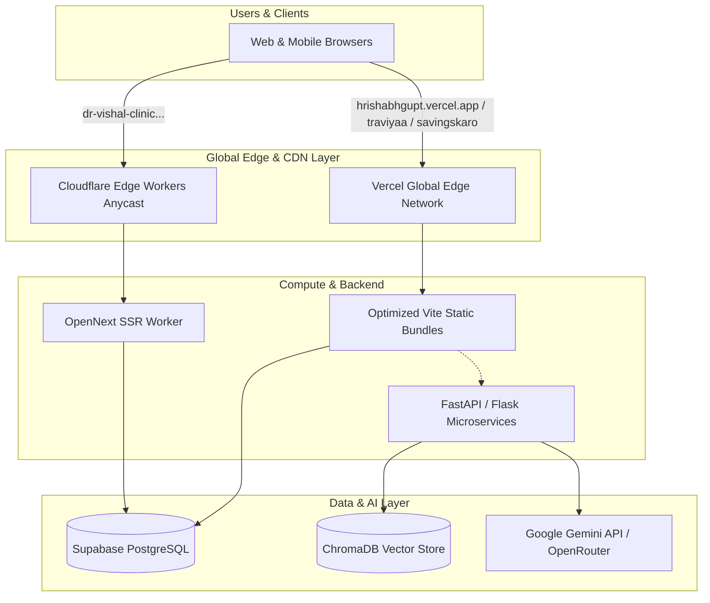

# 🌐 Centralized Live Projects Directory

<p align="center">
  
</p>

<p align="center">
  <a href="https://github.com/hrishabh1103"></a>
  <a href="https://hrishabhgupt.vercel.app/"></a>
  
  
</p>

---

## 🧭 Repository Overview

Welcome to my permanent, centralized directory of live applications, deployed web platforms, AI/ML models, client projects, and experimental technical implementations. 

As software engineers build and ship across multiple cloud ecosystems, critical deployment endpoints, hosting configurations, DNS records, and source repositories often become fragmented. This repository acts as the **single source of truth** for all my production URLs, infrastructure metadata, hosting providers, and deployment architectures.

> 🛡️ **Zero-Credential Guarantee:** This registry strictly preserves deployment metadata, infrastructure design, and public endpoints. No credentials, tokens, secret keys, or `.env` variables are stored.

---

## 📊 Live Deployment Statistics

<div align="center">

| Metric | Status / Count |
| :--- | :---: |
| **Total Projects Documented** | `13` |
| **🟢 Verified Live Deployments** | `10` |
| **🛠️ In Active Development / Local Demos** | `3` |
| **🟡 Pending Verification** | `0` |
| **Edge & Cloud Providers** | `Cloudflare Workers`, `Vercel`, `Custom Edge DNS` |
| **Database Engines** | `Supabase (PostgreSQL)`, `ChromaDB Vector Store` |
| **Last Automated Audit** | `2026-10-31` |

</div>

---

## 🏷️ Project Status Legend

| Indicator | Status Badge | Definition |
| :---: | :---: | :--- |
| **🟢** |  | **Production Live:** Public URL actively online and verified via HTTP `200 OK`. |
| **🟡** |  | **Needs Verification:** Public endpoint noted but currently undergoing DNS/uptime checks. |
| **🛠️** |  | **In Development:** Code complete or in progress; staging / local demonstration build. |
| **🔴** |  | **Offline:** Deployment confirmed unavailable, decommissioned, or expired. |
| **📦** |  | **Archived:** Preserved for code reference; active maintenance stopped. |

---

## 🏥 Client Projects

Production platforms engineered and deployed for client organizations.

| Project | Live Endpoint | Source Repository | Hosting | Tech Stack | Status | Last Audit |
| :--- | :--- | :--- | :--- | :--- | :---: | :---: |
| **[Dr. Vishal Clinic](projects/client-projects/dr-vishal-clinic.md)**<br><sub>Full-stack OPD clinic management and patient operations platform</sub> | [🔗 dr-vishal-clinic...workers.dev](https://dr-vishal-clinic.hrishabhbase.workers.dev/) | [📂 `Dr_Bhattacharya...`](https://github.com/hrishabh1103/Dr_Bhattacharya_Clinic_Management_System) | **Cloudflare Workers** (OpenNext) | Next.js 14, OpenNext, Supabase, TypeScript |  | `2026-10-31` |
| **[Traviyaa](projects/client-projects/traviyaa.md)**<br><sub>Indian homestay and travel booking platform (Airbnb alternative)</sub> | [🔗 traviyaa.vercel.app](https://traviyaa.vercel.app/) | [📂 `Traviya-an-Indian...`](https://github.com/hrishabh1103/Traviya-an-Indian-alternative-to-AirBnB-) | **Vercel** | React 18, Vite, TailwindCSS, Supabase |  | `2026-10-31` |

---

## 💼 Personal Projects & Startups

Proprietary platforms, startup products, and professional portals.

| Project | Live Endpoint | Source Repository | Hosting | Tech Stack | Status | Last Audit |
| :--- | :--- | :--- | :--- | :--- | :---: | :---: |
| **[Personal Portfolio](projects/personal-projects/portfolio.md)**<br><sub>Interactive 3D WebGL workstation portfolio</sub> | [🔗 hrishabhgupt.vercel.app](https://hrishabhgupt.vercel.app/) | [📂 `Profession_portfolio`](https://github.com/hrishabh1103/Profession_portfolio) | **Vercel** | Three.js, React Three Fiber, Framer Motion |  | `2026-10-31` |
| **[SavingsKaro](projects/personal-projects/savingskaro.md)**<br><sub>Credit card rewards optimization & discount portal</sub> | [🔗 savingskaro.vercel.app](https://savingskaro.vercel.app/) | [📂 `Savingskaro1.0`](https://github.com/hrishabh1103/Savingskaro1.0) | **Vercel** | React, TypeScript, Zustand, OpenAI API |  | `2026-10-31` |
| **[Career-Ops](projects/personal-projects/career-ops.md)**<br><sub>AI-powered job hunt orchestrator with 14 skill modes</sub> | [🔗 career-ops.org](https://career-ops.org) | [📂 `career-ops_hrishabh`](https://github.com/hrishabh1103/career-ops_hrishabh) | **Custom Domain** | Go, Claude Code, LaTeX, Shell |  | `2026-10-31` |
| **[Kautilyam / Zylar](projects/personal-projects/kautilyam.md)**<br><sub>Autonomous multi-agent SOC & cybersecurity portal</sub> | [🔗 kautilyam.vercel.app](https://kautilyam.vercel.app) | [📂 `Kautilyam`](https://github.com/hrishabh1103/Kautilyam) | **Vercel** | LangGraph, NetworkX, Ollama, Python |  | `2026-10-31` |
| **[Kisan Mitra](projects/personal-projects/kissan-mitra.md)**<br><sub>Farmer-first agri-waste reduction & machinery sharing</sub> | [🔗 kissanmitraa.vercel.app](https://kissanmitraa.vercel.app) | [📂 `Kissan_Mitra`](https://github.com/hrishabh1103/Kissan_Mitra) | **Vercel** | React, TypeScript, TailwindCSS, Vite |  | `2026-10-31` |
| **[Hrishabh's Blog](projects/personal-projects/hrishabh-blog.md)**<br><sub>Bilingual engineering publication (Hindi & English)</sub> | [🔗 hrishabhblog.vercel.app](https://hrishabhblog.vercel.app) | [📂 `Hrishabh_Blog_site`](https://github.com/hrishabh1103/Hrishabh_Blog_site) | **Vercel** | Next.js, MDX, TailwindCSS |  | `2026-10-31` |

---

## 🤖 AI & Machine Learning Projects

Advanced machine learning, NLP, computer vision, and generative AI systems.

| Project | Live Endpoint | Source Repository | Hosting | Tech Stack | Status | Last Audit |
| :--- | :--- | :--- | :--- | :--- | :---: | :---: |
| **[Genius AI Assistant](projects/ai-ml-projects/genius-ai-assistant.md)**<br><sub>Multilingual voice assistant & task manager</sub> | [🔗 minor-project02...vercel.app](https://minor-project02-genius-ai-assistant-lake.vercel.app/) | [📂 `Minor_Project02...`](https://github.com/hrishabh1103/Minor_Project02_Genius_Ai_Assistant) | **Vercel** / Local | React, Flask, Vosk, Gemini API, OpenRouter |  | `2026-10-31` |
| **[SocketComm AI Chat](projects/ai-ml-projects/socketcomm-ai-chat.md)**<br><sub>Real-time WebSocket chat & chunked file transmission</sub> | [🔗 socketcommaichat.vercel.app](https://socketcommaichat.vercel.app/) | [📂 `SocketComm-AI-Chat`](https://github.com/hrishabh1103/SocketComm-AI-Chat) | **Vercel** / Local | React, Flask-SocketIO, Eventlet, Python |  | `2026-10-31` |
| **[Virtual Stylist](projects/ai-ml-projects/virtual-stylist.md)**<br><sub>AI visual styling & fashion recommendation engine</sub> | *Pending Cloud Deployment* | *Local / Pending* | Target: **Render** | React, Flask, Scikit-learn, Python |  | `2026-10-31` |
| **[Video Analyzer](projects/ai-ml-projects/video-analyzer.md)**<br><sub>Automated CV face detection & license plate OCR</sub> | *Local / Demo Ready* | [📂 `VisionTrackai`](https://github.com/hrishabh1103/VisionTrackai) | Target: **Cloud Run** | OpenCV, face_recognition, EasyOCR, Supabase |  | `2026-10-31` |
| **[Customer Support Bot](projects/ai-ml-projects/customer-support-bot.md)**<br><sub>RAG support chatbot with vector similarity matching</sub> | *Local API Service* | [📂 `Pabbly_ChatBot`](https://github.com/hrishabh1103/Pabbly_ChatBot) | Target: **Railway** | FastAPI, ChromaDB, SentenceTransformers, Flan-T5 |  | `2026-10-31` |

---

## 🏛️ Deployment & Hosting Architecture

The portfolio projects leverage modern serverless and edge computing architectures to ensure high availability, zero cold-starts, and global caching:



---

## 📂 Repository Directory Tree

```
my-live-projects/
├── README.md                           # Main showcase and documentation
├── PROJECTS.md                         # Master tabular registry
├── CONTRIBUTING.md                     # Maintenance & onboarding guide
├── .gitignore                          # Security & build ignore rules
├── .github/
│   └── workflows/
│       └── health-check.yml            # Automated weekly endpoint health pings
│
├── projects/                           # Individual project specifications
│   ├── client-projects/
│   │   ├── dr-vishal-clinic.md
│   │   └── traviyaa.md
│   │
│   ├── personal-projects/
│   │   ├── portfolio.md
│   │   ├── savingskaro.md
│   │   ├── career-ops.md
│   │   ├── kautilyam.md
│   │   ├── kissan-mitra.md
│   │   └── hrishabh-blog.md
│   │
│   └── ai-ml-projects/
│       ├── genius-ai-assistant.md
│       ├── virtual-stylist.md
│       ├── video-analyzer.md
│       ├── customer-support-bot.md
│       └── socketcomm-ai-chat.md
│
├── assets/
│   ├── screenshots/                    # UI captures & project screenshots
│   └── logos/                          # High-resolution logos & badges
│
└── templates/
    └── project-template.md             # Standardized specification template
```

---

## 🔄 Adding New Projects

To maintain structure and consistency across all project entries:

1. Copy [`templates/project-template.md`](templates/project-template.md) into the appropriate folder under `projects/`.
2. Fill in all 14 mandatory attributes (Type, URLs, Hosting, Architecture, Tech Stack).
3. Verify public accessibility via `curl -I <url>`.
4. Update the tables in both [`README.md`](README.md) and [`PROJECTS.md`](PROJECTS.md).

For step-by-step contribution details, refer to [CONTRIBUTING.md](CONTRIBUTING.md).

---

## 📬 Contact & Profiles

- **Developer:** Hrishabh Gupta
- **Portfolio:** [hrishabhgupt.vercel.app](https://hrishabhgupt.vercel.app/)
- **GitHub:** [@hrishabh1103](https://github.com/hrishabh1103)
- **Email:** [hrishabh1104@gmail.com](mailto:hrishabh1104@gmail.com)

---

<p align="center">
  <sub>Maintained continuously as the single source of truth for all deployed technical creations.</sub>
</p>
